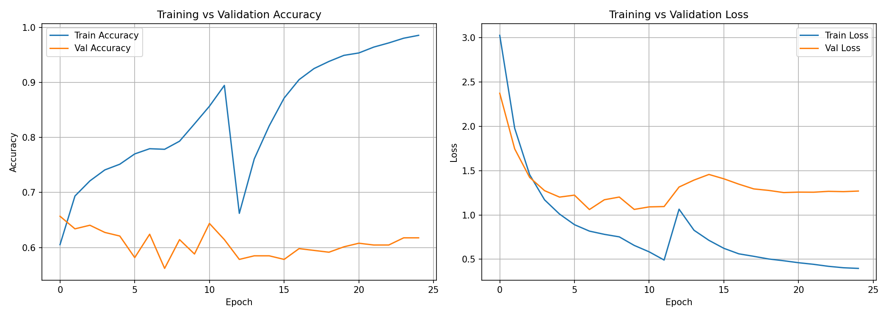
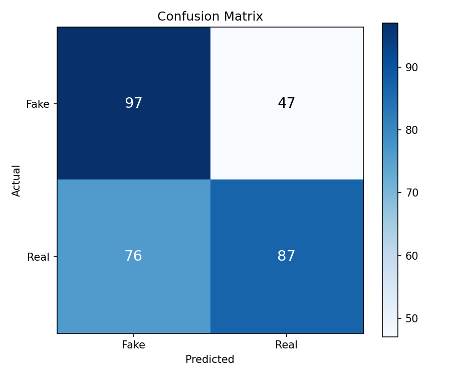

# Real vs. Fake Face Detector

A transfer-learning classifier that labels face photos as **real** or **manipulated**. It comes with a Streamlit app that explains each prediction with Grad-CAM and basic image forensics.


---

## Overview

Edited face images are easy to make and hard to spot by eye. This project fine-tunes an ImageNet-pretrained **MobileNetV2** to separate genuine face photos from manipulated ones. It then wraps the model in an app that shows *why* it decided, not only *what* it decided.

> **Results:** the model reaches **59.9 % accuracy on a held-out test set**, against 93.7 % on training data. It overfits heavily and is not a reliable detector yet. See [Results](#results) and [Next steps](#next-steps).

## Features

- **Two-phase transfer learning.** A classifier head is trained on MobileNetV2, then the top 30 base layers are fine-tuned at a lower learning rate.
- **Stratified 70 / 15 / 15 split** with a fixed seed. Augmentation covers brightness, contrast, rotation, zoom, flips and noise.
- **Evaluation artefacts.** Training curves, confusion matrices for the train and test splits, and a classification report.
- **Streamlit app (NeuralVision):**
  - upload an image and get a real/fake label with its confidence
  - image info: resolution, file size, channels, brightness, contrast
  - analysis: RGB histograms, brightness distribution, Laplacian edge map
  - **Grad-CAM** heatmap showing which regions drove the prediction
- **CLI prediction** for single images.

## Dataset

[Real and Fake Face Detection](https://www.kaggle.com/datasets/ciplab/real-and-fake-face-detection) (Kaggle, CIPLAB): **1,081 real** and **960 fake** faces. The fakes are expert-edited (Photoshop-style) composites, not GAN outputs. The dataset is not included in this repository.

Download it and place it next to the code folder:

```
Real-vs-Fake-image-detector/
├── real_and_fake_face/
│   ├── training_fake/
│   └── training_real/
└── fake-image-detector/
```

## Model

| Stage | Details |
|---|---|
| Input | 224 × 224 RGB, scaled to [0, 1] |
| Backbone | MobileNetV2 (ImageNet weights), global average pooling |
| Head | Dense 512 → BN → Dropout 0.4 → Dense 256 → BN → Dropout 0.5 → Dense 1 (sigmoid), L2 = 0.001 |
| Phase 1 | Adam 1e-3, up to 3 epochs, early stopping, LR-on-plateau |
| Phase 2 | Top 30 backbone layers unfrozen, Adam 1e-5, up to 10 epochs, best checkpoint kept |
| Loss | Binary cross-entropy, batch size 32 |

## Results

Recorded in [`fake-image-detector/training_summary.txt`](fake-image-detector/training_summary.txt):

| Split | Accuracy | Loss |
|---|---|---|
| Train | 93.7 % | 0.479 |
| **Test (307 images)** | **59.9 %** | 1.253 |

<table>
<tr>
<td width="62%"></td>
<td width="38%"></td>
</tr>
<tr>
<td align="center"><sub>Training vs. validation curves</sub></td>
<td align="center"><sub>Test confusion matrix</sub></td>
</tr>
</table>

Validation accuracy stays near 60 % while training accuracy keeps climbing, which is classic overfitting. On the test set the model finds 67 % of the fakes but only 53 % of the real faces.

> The committed curves show a 25-epoch run, while the current script caps training at 3 + 10 epochs. Re-run `train_model.py` to regenerate matching artefacts.

## Getting started

```bash
git clone https://github.com/Rishikesh10925/Real-vs-Fake-image-detector.git
cd Real-vs-Fake-image-detector/fake-image-detector

python -m venv venv
source venv/bin/activate          # Windows: venv\Scripts\activate
pip install -r requirements.txt
```

Train the model. This writes `fake_real_detector.h5` and the plots. Model weights are not committed.

```bash
python train_model.py
```

Predict a single image, or launch the app:

```bash
python predict.py ../sample_images/real_00029.jpg
streamlit run app.py
```

`test_sanity.py` runs the trained model over 30 real training images as a quick check for bias toward one class.

## Project structure

```
├── fake-image-detector/
│   ├── train_model.py        # split, augment, two-phase training, evaluation
│   ├── utils.py              # data loading, model, plots, Grad-CAM, image info
│   ├── app.py                # Streamlit app (NeuralVision)
│   ├── predict.py            # CLI prediction
│   ├── test_sanity.py        # quick class-bias check
│   ├── training_summary.txt  # recorded metrics
│   └── *.png                 # training curves, confusion matrices
└── sample_images/            # images for trying the app
```

## Next steps

Two issues in the current pipeline probably explain much of the overfitting:

1. **Phase 1 does not freeze the backbone.** `build_cnn` leaves MobileNetV2 layers 100 onward trainable, so "head-only" training at lr 1e-3 also updates pretrained layers. Setting `base_model.trainable = False` in `build_cnn` makes phase 1 match its intent.
2. **Input scaling.** MobileNetV2's ImageNet weights expect inputs in [-1, 1] (`tf.keras.applications.mobilenet_v2.preprocess_input`). The pipeline feeds [0, 1].

After that, try stronger augmentation, cross-validation for a dataset this small, and a face-forensics dataset such as FaceForensics++ for GAN or deepfake content.

## Author

Built by [Rishikesh](https://github.com/Rishikesh10925).
